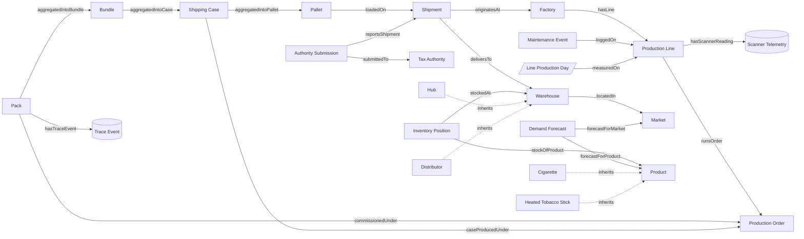

# Track & Trace ontology tutorial part 0: Introduction and environment setup

This tutorial shows how to build an ontology (preview) in Microsoft Fabric IQ for a Track & Trace operation,
and how to put agents on top of it for a demo. You create ontology elements manually and with the ontology
agent, and bind them to data in a lakehouse, an eventhouse and a semantic model. You enrich the ontology with
business definitions and rules, explore it in the canvas and as a graph, and query it with the ontology agent.
Then you connect Fabric data agents, Copilot and a mocked action agent to it, and rehearse the demo.

The structure follows the [Fabric IQ ontology (preview) tutorial](https://learn.microsoft.com/fabric/iq/ontology/tutorial-0-introduction),
which uses the fictional Lakeshore Retail company. This version uses the synthetic Track & Trace data in this folder.

> [!IMPORTANT]
> Ontology, the ontology agent and several of the agent integrations in part 5 are in preview. The click
> paths here follow the Learn tutorial. If the product looks different, follow the current Learn page.

> [!NOTE]
> All data is synthetic. Factories, brands, markets, tax authorities, logistics partners and people are
> fictional, and so are the two SOPs.

## What this demo demonstrates

### Core message

**Track & Trace as a decision-intelligence platform, not only a compliance system.** An email, a shipment
delay, a regulatory issue and an inventory risk are connected automatically, and Copilot helps the user
decide what to do next.

Today these signals sit in different places: serialization events on the packaging lines, shipments in
logistics, authority responses in the vendor's SaaS, stock in supply chain, and the explanations in emails
and Teams chats. The demo shows one person's morning in which an ontology and a few composable agents join
them up.

### Audience

Track & Trace business process owners and IT delivery: project managers, architects, service managers,
deployment teams and external consultants. The audience is mixed, technical and non-technical, so every
scene shows a business outcome first and the technology second.

### What the audience should leave with

| # | Takeaway | Where the demo shows it |
|---|---|---|
| 1 | How Fabric data agents work over Track & Trace data | Scenes 2 and 4: the T&T Data Agent answers from the ontology, across lakehouse, eventhouse and semantic model data |
| 2 | Why semantic business context (ontology, IQ) matters | Scene 2: "aggregation mismatch", "bypass mode" and "missing aggregation data" are understood as business terms and linked across tables, through the rules from part 2 |
| 3 | How Copilot becomes the UI for multiple, composable agents | Scenes 1, 5 and 6: one Copilot conversation calls the T&T Data Agent, the Supply Chain Agent and the action tools |
| 4 | How Track & Trace connects with supply chain and work context | Scenes 3 and 5: a carrier's email leads to the affected pallets and then to a stock risk in Market Beta |
| 5 | How AI supports decisions, not just answers questions | Scenes 5 and 6: a stock-transfer recommendation, an incident and a partner email draft that a human approves |

### Demo principles

- **Inspiration.** Show what AI can do today, and where it goes in 6 to 12 months.
- **Finished results, no live building.** This tutorial is the preparation. The demo itself is part 6.
- **Fabric data agents over semantic and raw data, invoked from Copilot.** The user never opens Fabric during
  the demo.
- **IQ decides what's relevant.** Work IQ picks the emails that matter for a Track & Trace decision. Fabric IQ
  supplies the business meaning of the data.
- **Composable agents that can live anywhere.** The data agents could run in the serialization vendor's Fabric
  tenant and an incident agent in the IT service management tool. All of them plug into Copilot as the
  "UI for AI".
- **Close the loop with supply chain.** The demo ends with a supply decision, not with a compliance report.

### The storyline at a glance

Each scene is one prompt in Copilot. One or more agents answer, and the result is visible on screen. Part 6
has the full script with prompts and expected answers.

| # | Time | Scene | Agents | Data used |
|---|---|---|---|---|
| 1 | 08:00 | **Morning briefing.** Overnight status: volumes, aggregation errors, failed submissions, and only the emails that matter | Copilot, Work IQ, T&T Data Agent | Events, KPIs, mailbox |
| 2 | 08:15 | **Anomaly drill-down.** Why did PL-02 Line 3 have an aggregation mismatch yesterday? Root cause: a scanner fault; {{s1_cases}} cases affected | T&T Data Agent | Shipping cases, line master, maintenance log, scanner telemetry |
| 3 | 09:00 | **Relevant email surfaced.** A carrier reports a delayed truck; the agent links it to the pallets, cases and packs on board | Work IQ, T&T Data Agent | Emails, shipments, aggregation tree |
| 4 | 10:00 | **Authority request.** Full trace of one pack, from pack to distributor, and a draft response | T&T Data Agent, Work IQ | Full hierarchy, shipments, submissions, SOP |
| 5 | 11:00 | **Close the loop with supply chain.** Delay plus low stock in Market Beta: supply risk, and a stock-transfer proposal | Supply Chain Agent, T&T Data Agent | Inventory, demand, shipments |
| 6 | 14:00 | **Action.** Create an incident (mocked), a task and a draft partner email; a human approves | T&T Copilot action tools | Generated items |
| 7 | 16:00 | **Governance teaser (optional).** Which agents acted, on which data, under which identity | Agent inventory (mocked) | Agent activity |

### What's real and what's mocked

| Component | In the demo | Real or mocked |
|---|---|---|
| Lakehouse, eventhouse, semantic model, ontology | Fabric IQ items built in parts 0 to 3 | Real Fabric items with synthetic data |
| T&T Data Agent, Supply Chain Agent | Fabric data agents (part 5) | Real, over synthetic data |
| Emails, Teams messages, SOPs | Work IQ in Microsoft 365 Copilot | Real Microsoft 365 items with fictional content |
| Serialization platform (line systems and the vendor's SaaS) | Represented by the lakehouse and eventhouse tables | Mocked |
| IT service management incident | A SharePoint list, "T&T Incidents (mock ITSM)" | Mocked |
| Tax authorities | Authority submission records and emails | Mocked |
| Agent registry | Scene 7 | Mocked |

## Scenario

Marta K. is a Track & Trace Operations Specialist at the regional hub of a fictional tobacco manufacturer.
She looks after three factories (PL-01 Oakridge Plant, PL-02 Riverbend Plant and CZ-01 Silverbrook Plant)
and four markets (Market Alpha to Market Delta). She monitors serialization and aggregation, investigates
anomalies, answers authority requests, coordinates with logistics and escalates incidents. Today she
reconciles across systems by hand, chases emails, detects aggregation errors late, and needs a long time to
answer an authority's query.

**How Track & Trace works in this scenario.** On the packaging line, each pack gets a unique serial code (UID).
This is *commissioning*. Packs are *aggregated* into a bundle, bundles into a shipping case, and cases into a
pallet, and each step links the child UIDs to the parent UID. Pallets leave the factory on shipments
(*dispatch*) to hubs and distributors in the market of destination (*arrival*), and the market's tax authority
gets a notification for each dispatch or arrival (*authority submission*). Consumers can scan a pack to see
where it was produced. Track & Trace is mission critical: if it's down, products can't be sold or shipped.

It's {{today_long}}, 08:00 in Kraków. Since yesterday morning, several things have happened that are connected
but sit in different systems and inboxes:

| ID | What happened | Where it shows up |
|---|---|---|
| S1 | **Aggregation mismatch** on PL-02 Line 3 on {{yday_short}}: {{s1_cases}} shipping cases hold fewer bundles than expected | Shipping cases, maintenance log, scanner telemetry, a shift lead's email, the Teams shift handover |
| S2 | **Delayed shipment**: truck `{{s2_ship}}` to Market Beta left {{s2_delay}} hours late | Shipments, an email from the carrier |
| S3 | **Authority rejection**: Market Gamma rejected two dispatch notifications for missing aggregation data | Authority submissions, two authority emails, an email from Compliance |
| S4 | **Trace request**: Market Beta's authority asks for the full trace of pack `{{s4_pack}}` | Pack, bundle, shipping case, pallet, shipment and warehouse, an authority email |
| S5 | **Supply risk**: {{s5_d1_name}} has {{s5_d1_cover}} days of {{s5_sku}} left, and its replenishment is on the late truck | Inventory, demand forecast, an email from the 3PL |
| S6 | **Consumer scan anomaly** (optional): the same pack was scanned in two countries {{s6_hours}} hours apart | Consumer scans |

This tutorial works toward one concrete operational question, the equivalent of Lakeshore's "high-priority
stores in the West" question:

> Which shipments dispatched on {{yday}} contain shipping cases with an aggregation mismatch, which
> authority submissions were rejected because of them, and what do the maintenance log and the scanner
> telemetry of the producing line show for the same time?

With a robust ontology, an agent can answer it. Design the ontology so that the agent understands that a pack
is aggregated into a bundle, a shipping case and a pallet; what an aggregation mismatch, a degraded scanner and
a submission SLA breach mean; how shipping cases connect to production orders, lines and factories; how pallets
connect shipments to warehouses and markets; and which authority submissions report which shipments.

### Ontology

The Track & Trace elements in this tutorial form the following ontology. Cylinders are eventhouse data and the
parallelogram is the semantic model; the dotted arrows are inheritance.



Part 1 also lists optional relationships (product, market, carrier, tax authority and consumer scan links)
that add context but aren't needed for the storyline.

## Prerequisites

For parts 0 to 4 (as in the Learn tutorial):

- A workspace with a Microsoft Fabric-enabled capacity. Use it for everything you create in this tutorial.
- The tenant settings **Users can create ontology (preview) items** and **Users can create Fabric items**. A
  Fabric administrator enables them in **OneLake catalog > Govern > Configurations > Tenant settings**.

For parts 5 and 6 (the demo agents):

- A paid F2 or higher capacity (or P1 or higher with Fabric enabled), and the
  [Fabric data agent tenant settings](https://learn.microsoft.com/fabric/data-science/data-agent-tenant-settings),
  including **Users can use Copilot and other features powered by Azure OpenAI**. If your capacity is outside
  the EU Data Boundary and the US, also allow data sent to Azure OpenAI to be processed and stored outside
  your capacity's geographic region.
- A demo user for Marta with a Microsoft 365 Copilot license and a mailbox. Use a test tenant or a dedicated
  demo account, not your own mailbox, because you'll import fictional emails into it.
- Access to a Copilot Studio environment, and a SharePoint site where you can create a list.

## Download sample data

Download the `docs-samples/iq/ontology/new-experience` folder (the [parent of this `tutorial` folder](../)) from the
`pmi-track-and-trace-ontology` branch of this repository. On GitHub, select **Code > Download ZIP**, or fetch
only this folder:

```bash
git clone --depth 1 --branch pmi-track-and-trace-ontology --filter=blob:none --sparse <repository URL>
cd fabric-samples
git sparse-checkout set docs-samples/iq/ontology/new-experience
```

The sample data has static entity data and transactions for the lakehouse (`lakehouse/`), event and streaming
data for the eventhouse (`eventhouse/`), a notebook that creates the KPI semantic model (`notebooks/`), and the
emails, Teams messages and SOPs for the work context (`work-context/`). [`README_data.md`](../README_data.md)
lists the row counts and where each scenario lives.

## Prepare the lakehouse

Follow these steps to load the sample data into a lakehouse.

1. Start in your Fabric workspace. Use the **+ New item** button to create a new **Lakehouse** item.
1. For the lakehouse **Name**, enter *TrackTraceLH*. For **Location**, select your workspace.
1. Keep the **Lakehouse schemas** checkbox selected (default) and select **Create**. The new lakehouse opens
   when it's ready.
1. From the lakehouse ribbon, select **Get data > Upload files**. Upload all the CSV files in the `lakehouse`
   folder (17 files).
1. Upload the `pack` subfolder as a folder, so its {{pack_parts}} part files sit in **Files/pack**. If your
   browser can't upload folders, create a folder named *pack* under **Files** and upload the part files into it.
1. Don't upload the `eventhouse` files; they go to the eventhouse in the next section. Don't upload the
   `semantic-model` file; the notebook creates the semantic model.
1. Load each file to a delta table. For each CSV file, select **...** next to the file name, then
   **Load to Tables > New table**. Keep the default settings. The default table names are the file names in
   lowercase (`factory`, `production_line`, and so on).
1. For the **pack** folder, select **...** next to the folder, then **Load to Tables > New table**. Name the
   table *pack*, keep the file type **CSV** with a header row, and confirm. All part files load into one table.

When you're done, the lakehouse has 18 tables under **Tables > dbo**. Check a few row counts against
`README_data.md`, for example `pack` and `shipping_case`.

## Prepare the eventhouse

Follow these steps to load the event and telemetry data into a KQL database in an eventhouse.

1. In your Fabric workspace, select **+ New item** to create a new **Eventhouse** called *TrackTraceEH*. Fabric
   creates a default KQL database with the same name. The eventhouse opens when it's ready.
1. Open the KQL database by selecting its name in the explorer.
1. In the menu ribbon, select **Get data > Local file**. Create a **New table** called *TraceEvent*, and select
   all the files in `eventhouse/trace_event/` at once. Continue through the dialog with the default settings.
1. Select **Get data > Local file** again. Create a **New table** called *LineScannerTelemetry* from
   `eventhouse/line_scanner_telemetry.csv`, with the default settings.

When you're done, the KQL database shows the tables **TraceEvent** (every commission, aggregate, dispatch,
arrive, decommission and consumer-scan event) and **LineScannerTelemetry** (5-minute read rates of the
aggregation scanners).

## Create the semantic model

The Learn tutorial uploads a `.pbix` file. This tutorial creates its semantic model, **TrackTraceKPIs**, with a
notebook instead, so you don't need Power BI Desktop.

1. In your Fabric workspace, select **Import > Notebook > From this computer**, and choose
   `notebooks/create_semantic_model.ipynb`.
1. Open the notebook and select **Run all**. You don't need to attach a lakehouse; the data is embedded in the
   notebook.
1. The notebook creates and refreshes the semantic model **TrackTraceKPIs** with the table `ProductionDaily` and
   three measures: **Packs Commissioned**, **Aggregation Error Rate %** and **Plan Attainment %**. Its last cell
   lists the five line-days with the highest aggregation error rate: {{s1_line}} on {{yday}} is at the top
   with {{s1_line_rate}}.

## Next steps

Now your sample scenario is set up in Fabric. Next, create an ontology (preview) item and add elements to it
that connect to these data sources: [Create an ontology](tutorial-1-create-ontology.md).
