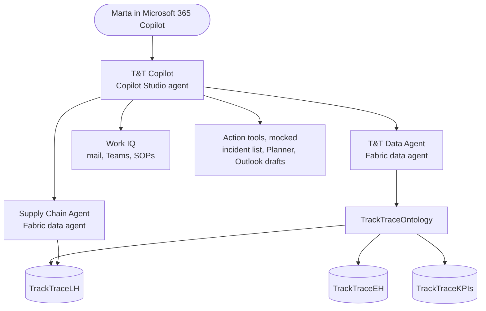

# Track & Trace ontology tutorial part 5: Build the demo agents

In this tutorial step, you build the agents that the demo shows, and connect them to Copilot. This part goes
beyond the Learn tutorial. Each step follows a Learn article, linked in the section.

## How the agents fit together



| Agent | Built with | Grounding | Example prompt |
|---|---|---|---|
| **T&T Data Agent** | Fabric data agent | TrackTraceOntology | "Trace pack {{s4_pack}}" |
| **Supply Chain Agent** | Fabric data agent | TrackTraceLH: inventory, demand forecast, shipments | "Which markets are at stock risk this week?" |
| **Work context** | Work IQ | Marta's mailbox, Teams and the SOPs | "Which of my emails affect today's Track & Trace decisions?" |
| **Action Agent** (mocked) | Tools of the Copilot Studio agent | Mock incident list, Planner, Outlook drafts | "Open an incident and draft a reply to the partner" |
| **T&T Copilot** (orchestrator) | Copilot Studio, published to Microsoft 365 Copilot | All of the above | Chains scenes 1 to 6 |

This is the composability message of the demo (takeaway 3). Each agent owns one domain and could live somewhere
else: the T&T Data Agent in the serialization vendor's Fabric tenant, the Supply Chain Agent in the supply chain
team's workspace, the incident tool in the IT service management system. Copilot is the one UI on top. The
Supply Chain Agent deliberately reads the lakehouse tables instead of the ontology, to show that agents over
different data still combine in one conversation.

## Create the T&T Data Agent

Follow [Create a data agent grounded in an ontology](https://learn.microsoft.com/fabric/iq/ontology/how-to-create-data-agent).

### Check the semantic model known issue first

At the time of writing, that article notes that a data agent doesn't work with an ontology that uses semantic
models for binding. Your ontology binds **Line Production Day** to the **TrackTraceKPIs** semantic model. Check
the article for the current status. If the note is still there:

1. In **TrackTraceOntology**, delete the **measuredOn** relationship type, and then the **Line Production Day**
   entity type.
1. In step 3 below, add **TrackTraceKPIs** to the data agent as a second data source. The agent keeps the KPI
   measures, and the ontology keeps everything else.

If you need Line Production Day for the ontology agent again later, add it back as in part 1.

### Create the agent

1. In your Fabric workspace, use **+ New item** to create a new **Data agent** item named
   *Track and Trace Data Agent*. The agent opens when it's ready.
1. Select **Add a data source**. Search for **TrackTraceOntology** and select **Add**. When the agent is ready,
   the ontology and its entity types are visible in the **Explorer**.
1. If you removed Line Production Day, select **Add a data source** again and add the **TrackTraceKPIs** semantic
   model.
1. Select **Agent instructions** from the ribbon and enter the following text. The last line addresses a known
   issue with aggregation in queries; keep it at the bottom.

   ```text
   You answer questions about a fictional Track & Trace operation: 3 factories (PL-01, PL-02, CZ-01),
   12 production lines and 4 markets (Market Alpha to Market Delta).
   - All timestamps are UTC. The data snapshot is {{as_of}}. "Today" is {{today_iso}} and
     "yesterday" is {{yday_iso}}.
   - Hierarchy: pack -> bundle -> shipping case -> pallet -> shipment -> warehouse -> market.
     Use the ontology relationships to move between the levels.
   - Packs and bundles exist for production from {{detail_start}}. Shipping cases, pallets, shipments
     and submissions cover 30 days.
   - Production quantities are packs. Stock and forecast quantities are shipping cases.
   - When a question uses the name of an ontology rule (Aggregation mismatch, Scanner degradation,
     Delayed shipment, Submission SLA breach, Supply risk, Suspicious consumer scan), apply the rule.
   - For a trace request, return: factory, line, production order, commissioning time, bundle,
     shipping case, pallet, shipment with dispatch and arrival times, carrier, receiving warehouse,
     and the authority submissions for the shipment with their status.
   - Always list the IDs and the time window you used.
   Support group by in GQL
   ```

1. Test the agent with the questions from [part 4](tutorial-4-use-agent.md). Notice that the answers refer to
   entity types and relationships, not raw tables. If you see errors saying there's no data, wait a few minutes
   for the agent to initialize, and ask again.
1. Select **Publish**. Enter this description, which Copilot Studio uses later to decide when to call the agent:

   ```text
   Answers questions about Track & Trace serialization and aggregation: packs, bundles, shipping cases
   and pallets, production lines and orders, maintenance and aggregation scanner telemetry, shipments,
   tax-authority submissions and consumer scans. Returns the full trace of a pack from production to
   the receiving warehouse. Grounded in the TrackTraceOntology ontology.
   ```

   To also use the agent directly in Microsoft 365 Copilot (the fallback path in part 6), select
   **Publish to Agent Store**. See [Consume a data agent from Microsoft 365 Copilot](https://learn.microsoft.com/fabric/data-science/data-agent-microsoft-365-copilot).

## Create the Supply Chain Agent

1. Use **+ New item** to create another **Data agent** named *Supply Chain Agent*.
1. Select **Add a data source** and add the **TrackTraceLH** lakehouse. In the **Explorer**, select only these
   tables: `inventory_snapshot`, `demand_forecast`, `warehouse`, `product`, `market`, `shipment`, `pallet` and
   `partner`.
1. Select **Agent instructions** and enter:

   ```text
   You answer supply chain questions for a fictional Track & Trace operation.
   - Quantities in inventory_snapshot and demand_forecast are shipping cases (uom = CASE).
   - "Now" is the latest snapshot_date in inventory_snapshot ({{today_iso}} in this data set).
   - Daily demand of a warehouse for a SKU = the average forecast_qty of the next 7 days for the
     warehouse's market and SKU, times warehouse.demand_share_pct / 100.
   - Days of cover = qty_on_hand / daily demand. Below 3 days of cover is a supply risk.
   - A warehouse in the same market with more than 7 days of cover can transfer stock: the quantity
     above 7 days of its own demand. Propose whole pallets (product.cases_per_pallet).
   - qty_in_transit arrives with shipments to the warehouse that are IN_TRANSIT or DELAYED. Name the
     shipment, its status and its estimated_arrival.
   - Always show warehouse, SKU, stock on hand, daily demand and days of cover.
   ```

1. Add an example query to the lakehouse source, so the agent computes days of cover the same way every time.
   Question: *What is the days of cover per warehouse and SKU?* Query:

   ```sql
   -- Days of cover per warehouse and SKU at the latest inventory snapshot (shipping cases).
   WITH latest AS (
       SELECT MAX(CAST(snapshot_date AS date)) AS snapshot_date
       FROM dbo.inventory_snapshot
   ),
   daily_demand AS (
       SELECT w.warehouse_id,
              f.sku,
              AVG(CAST(f.forecast_qty AS float)) * w.demand_share_pct / 100.0 AS cases_per_day
       FROM dbo.demand_forecast AS f
       JOIN dbo.warehouse AS w ON w.market_id = f.market_id
       CROSS JOIN latest AS l
       WHERE CAST(f.forecast_date AS date) >= l.snapshot_date
         AND CAST(f.forecast_date AS date) < DATEADD(day, 7, l.snapshot_date)
       GROUP BY w.warehouse_id, f.sku, w.demand_share_pct
   )
   SELECT i.warehouse_id,
          w.name AS warehouse_name,
          w.market_id,
          i.sku,
          i.qty_on_hand,
          i.qty_in_transit,
          ROUND(d.cases_per_day, 1) AS cases_per_day,
          ROUND(i.qty_on_hand / NULLIF(d.cases_per_day, 0), 1) AS days_of_cover
   FROM dbo.inventory_snapshot AS i
   JOIN latest AS l ON CAST(i.snapshot_date AS date) = l.snapshot_date
   JOIN dbo.warehouse AS w ON w.warehouse_id = i.warehouse_id
   JOIN daily_demand AS d ON d.warehouse_id = i.warehouse_id AND d.sku = i.sku
   ORDER BY days_of_cover;
   ```

   The first row must be {{s5_d1}} / {{s5_sku}} with {{s5_d1_cover}} days of cover; {{s5_d2}} / {{s5_sku}} has
   {{s5_d2_cover}}.
1. Test with *Which warehouses are below 3 days of cover, and where can stock come from?* Expect only {{s5_d1}}
   ({{s5_d1_name}}) for {{s5_sku}} {{s5_brand}}, with {{s5_d2}} as the source: about {{s5_release}} cases above its
   7 days, so {{s5_pallets}} pallets of {{s5_cpp}} cases.
1. Select **Publish** with this description:

   ```text
   Answers supply chain questions: stock on hand and in transit per warehouse and SKU, demand forecast,
   days of cover, supply risk, and stock transfers between warehouses of the same market. Knows the
   shipments that bring stock in transit and their estimated arrival.
   ```

## Prepare the work context

Work IQ grounds Microsoft 365 Copilot in the user's mail, chats and files. Put the fictional work context into
the demo user's Microsoft 365 at least a day before the demo, so it's indexed in time.

1. **Emails.** Sign in to classic Outlook for Windows as the demo user and drag all {{email_count}} `.eml` files
   from `work-context/emails/` into the **Inbox**. Check that they show their original dates. The set has
   {{email_relevant}} relevant emails and {{email_noise}} noise emails (lunch menus, newsletters, training
   reminders): the noise is the point, because scene 1 shows that Copilot surfaces only the ones that matter.
   The relevant ones are:

   {{email_table}}

1. **SOPs.** Upload `work-context/sop/SOP-TT-014_handling_aggregation_mismatches.md` and
   `SOP-TT-021_responding_to_authority_trace_requests.md` to a SharePoint document library, or to a folder in the
   demo user's OneDrive. If Copilot doesn't find the `.md` files, paste each into a Word document, save it as
   `.docx`, and upload that instead.
1. **Teams messages (optional).** The messages in `work-context/teams_messages.json` can't be imported with their
   original authors and times. Post the relevant ones in a *Shift Handover* channel of a demo team, or skip them;
   the emails cover the same facts.

   {{teams_table}}

1. **Check.** In Microsoft 365 Copilot, signed in as the demo user, ask: *Which of my emails since {{yday}} are
   about shipment delays or authority rejections?* Copilot should find the Northgate Haulage delay notice and
   the two Gamma rejections.

## Create the mock incident list

The demo doesn't connect to a real IT service management tool. A SharePoint list stands in for it.

1. In a SharePoint site the demo user can edit, select **+ New > List > Blank list** and name it
   *T&T Incidents (mock ITSM)*.
1. Add these columns: **Priority** (choice: P1, P2, P3), **Category** (choice: Aggregation, Shipment,
   Authority, Supply), **Line** (single line of text), **Related IDs** (multiple lines of text), **Details**
   (multiple lines of text) and **Status** (choice: New, In progress, Resolved; default New).
1. Optionally, create a Planner plan named *Track & Trace Operations* for the tasks the agent creates.

## Build T&T Copilot in Copilot Studio

T&T Copilot is the orchestrator: one agent in Microsoft 365 Copilot that calls the two data agents, reads the
work context and runs the actions. Follow [Add a Fabric data agent as a tool in Microsoft Copilot Studio](https://learn.microsoft.com/fabric/data-science/data-agent-microsoft-copilot-studio-tool).

1. Go to [Copilot Studio](https://copilotstudio.microsoft.com/) and select your environment. On the left pane,
   select **Agents**. Select the arrow next to **New agent**, and then select **Agent** under
   **Optimize your business processes**. Name the agent *Track and Trace Copilot*.
1. **Add the data agents.** On the **Build** tab, go to **Tools** and select **+**. Search for *Fabric* and select
   **Fabric IQ Data MCP**. Create a connection if you don't have one. The OneLake catalog lists the published
   data agents you can use: select **Track and Trace Data Agent**.
1. Select the added data agent and paste the description from its publishing step. Select the authentication
   mode **User**, so the agent reads the data as the demo user.
1. Repeat the two previous steps for **Supply Chain Agent**.
1. **Add the work context.** Give the agent access to Outlook mail, Teams and the SOP files through
   [Work IQ](https://learn.microsoft.com/microsoft-copilot-studio/agents-experience/add-work-iq), limited to
   those workloads. Also add the SOP library or folder as a knowledge source.
1. **Add the action tools.** Add these connector actions as tools, with clear descriptions:
   - **SharePoint – Create item**, on the *T&T Incidents (mock ITSM)* list: "Creates an incident in the mock IT
     service management tool."
   - **Planner – Create a task**, in the *Track & Trace Operations* plan: "Creates a follow-up task."
   - **Office 365 Outlook – Draft an email message**: "Creates an email draft. Never sends."
1. Select **Instructions** and enter:

   ```text
   You are T&T Copilot, the assistant of Marta K., Track & Trace Operations Specialist at a regional hub.
   You help her decide what to do next, not only answer questions.

   Context: today is {{today_long}}. The data snapshot is {{as_of}}. "Yesterday" is {{yday}}.
   Times are UTC unless she asks for local time (Europe/Warsaw).

   Tools:
   - Track and Trace Data Agent: serialization and aggregation (packs, bundles, shipping cases, pallets),
     production lines and orders, maintenance and scanner telemetry, shipments, authority submissions,
     consumer scans, and full pack traces.
   - Supply Chain Agent: stock, days of cover, demand forecast, in-transit stock, stock transfers.
   - Work IQ: Marta's emails, Teams messages and the SOP documents. Bring up only messages that affect
     Track & Trace decisions: production or aggregation issues, shipment delays, authority requests or
     rejections, stock notes from logistics partners. Ignore newsletters, HR, facilities and other noise.
   - Incident list, Planner and Outlook: create incidents and tasks, and draft emails.

   How to work:
   - When an email mentions a shipment, pallet, case or pack ID, look it up with the Track and Trace
     Data Agent and say what is affected.
   - When a shipment to a market is delayed, ask the Supply Chain Agent about stock risk in that market
     and propose a concrete action.
   - Follow SOP-TT-014 for aggregation mismatches and SOP-TT-021 for authority trace requests.
   - Before you create an incident or a task, show its fields and ask Marta to confirm.
   - Never send an email. Create drafts only, and say that a person must review and send them.
   - Name the source of each fact (agent, email or SOP) and keep IDs exactly as the tools return them.
   ```

1. Select **Save**. You must save before you test or publish, or the tools, descriptions and instructions aren't
   applied.
1. Go to the **Preview** tab and try the prompts from [part 6](tutorial-6-run-the-demo.md). Open the activity
   trace to check which tool each answer used. If the agent doesn't call a data agent, improve that tool's
   description or the instructions, then save and test again.
1. Select **Publish**. In the **Agent published** dialog, select the channel **Teams + Microsoft 365**, select the
   checkbox to turn it on, and select **Make agent available in Microsoft 365 Copilot**. Select
   **Save and publish**, then **See agent in Microsoft 365** to open it.

> [!NOTE]
> Agent types in Copilot Studio differ in the tools they offer. At the time of writing, Learn documents the
> Fabric data agent tool for the agent type created above, and Work IQ for agents on the Microsoft Copilot
> harness. If you can't combine the data agents, Work IQ and the action tools in one agent in your tenant, keep
> the data agents and actions in T&T Copilot and run the email parts of scenes 1, 3 and 4 in Microsoft 365
> Copilot Chat, which uses Work IQ out of the box. There you can @mention T&T Copilot or the published data
> agents, so the demo still runs in one window.

## Optional: an operations agent as a look ahead

A [Fabric operations agent](https://learn.microsoft.com/fabric/iq/ontology/how-to-create-operations-agent)
monitors the ontology continuously and can notify you in Microsoft Teams when a condition matches your goals.
Pointed at the *Scanner degradation* and *Aggregation mismatch* rules, it would have alerted Marta at about
{{s1_first}} on {{yday}}, when the first mismatched case was packed, instead of in the next morning's briefing.
You don't need to build it for the demo; it's a good closing point for "where this goes in 6 to 12 months".

## Checklist before the demo

- [ ] The T&T Data Agent answers the part 4 questions with the expected values.
- [ ] The Supply Chain Agent returns {{s5_d1_cover}} days of cover for {{s5_d1}} / {{s5_sku}}.
- [ ] Microsoft 365 Copilot finds the Northgate Haulage delay email for the demo user.
- [ ] T&T Copilot is published and opens in Microsoft 365 Copilot.
- [ ] The mock incident list exists and is empty, and there are no old drafts in the demo mailbox.

## Next steps

All agents are in place. Next, rehearse the storyline: [Run the demo](tutorial-6-run-the-demo.md).
